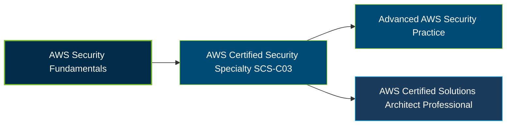

# AWS Certified Security - Specialty (SCS-C03) Certification Exam Guide

A dedicated, comprehensive study guide and cloud security reference repository for candidates preparing for the **AWS Certified Security - Specialty (SCS-C03) Certification Exam**.

---

## Exam Overview

The AWS Certified Security - Specialty certification validates advanced technical knowledge and skills in securing AWS workloads, implementing data protection, managing security operations, and applying security controls across cloud environments.

- **Exam Format**: Multiple-choice, multiple-response, ordering, and matching questions; testing center or online proctored exam
- **Target Audience**: Cloud security engineers, security architects, security operations professionals, and IT professionals responsible for securing AWS workloads
- **Prerequisites**: No formal prerequisite; AWS recommends the equivalent of 3–5 years of experience securing cloud solutions

---

## Core Exam Domains & Knowledge Areas

### 1. Detection

- Monitoring AWS environments using security logs, events, and findings.
- Detecting suspicious activity, threats, and configuration issues.
- Analyzing security alerts and investigating potential risks.

### 2. Incident Response

- Preparing incident response procedures and security playbooks.
- Investigating security events and identifying root causes.
- Containing incidents, remediating threats, and supporting recovery.

### 3. Infrastructure Security

- Securing AWS network infrastructure, workloads, and services.
- Implementing network controls, firewalls, and vulnerability management.
- Applying secure configurations and reducing infrastructure risks.

### 4. Identity and Access Management

- Managing identities, permissions, roles, and access policies.
- Applying least privilege and multi-account security controls.
- Monitoring access activity and strengthening authentication.

### 5. Data Protection

- Applying encryption and key management for data at rest and in transit.
- Implementing data classification, access controls, and protection mechanisms.
- Managing backup strategies, recovery controls, and data security requirements.

### 6. Security Foundations and Governance

- Applying the AWS shared responsibility model and security best practices.
- Managing security policies, compliance requirements, and risk assessments.
- Evaluating trade-offs involving security, cost, and deployment complexity.

---

## Certification Path

This is a suggested learning progression, not an official prerequisite or mandatory AWS certification pathway.

---

## Recommended Practice & Study Resources

Combine official AWS exam preparation materials with practical security exercises to reinforce cloud security concepts and identify knowledge gaps.

- **CertsGate**: Explore [SCS-C03 certification preparation resources](https://certsgate.com/exams/amazon-web-services/scs-c03) for supplementary study materials and practice questions.
- **Practical AWS Security Study**: Use the [AWS Security Documentation](https://docs.aws.amazon.com/security/) to explore identity and access management, threat detection, incident response, encryption, and security controls.
